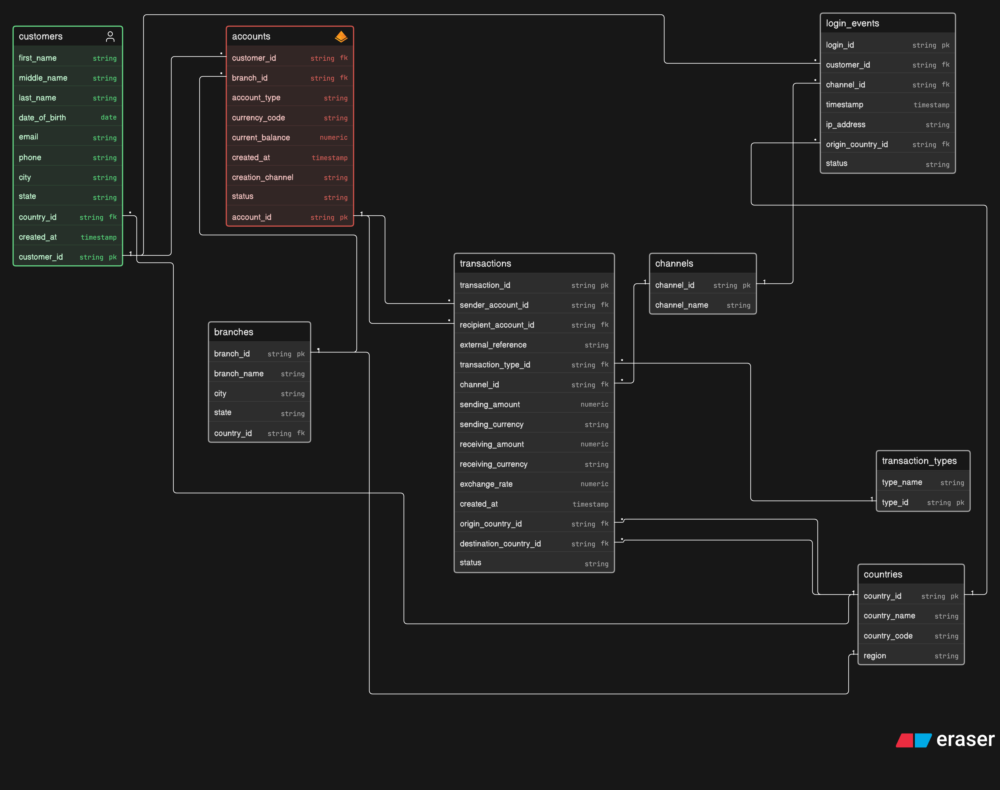

# RiskQL — Banking Risk Analytics (SQL + Python)

A learning-focused portfolio project that models a simplified **global banking
environment** in PostgreSQL and uses SQL and Python to investigate **operational
and supporting risk indicators**.

> **Important.** This is a conceptual model built for learning. It does **not**
> represent the internal systems, data, or risk models of any real financial
> institution. All data is **synthetic** (generated by `src/generate_data.py`)
> and does not represent any real person, account, or transaction. The analysis
> produces **risk indicators** — patterns that may warrant further investigation
> — **not** proof of fraud, money laundering, or financial crime.

---

## 1. Overview & business problem

A global bank wants to better identify and monitor potentially elevated-risk
activity across customers, accounts, transactions, channels, branches,
countries, and digital (login) activity. Raw operational data doesn't provide
that insight directly. RiskQL builds the relational model and the SQL/Python
analysis needed to surface **interpretable indicators** a Global Risk Management
team could monitor.

See [`docs/business_scenario.md`](docs/business_scenario.md) for the full
scenario and the business questions that drive the analysis.

## 2. Risk scope

- **Primary:** Operational risk — transaction/login failures, channel and
  process concentration, unusual operational patterns.
- **Supporting:** transactional, geographic, and digital-activity indicators.

Every output is treated as an **indicator**, not evidence. Cross-border activity,
high value, or a login from another country all have innocent explanations and
are only meaningful *in context*.

## 3. Architecture

```
CSV (synthetic, seeded)          PostgreSQL                      Analysis
──────────────────────   ─────────────────────────   ──────────────────────────
src/generate_data.py  →  data/processed/*.csv  →  \copy  →  tables
                                                            │
 sql/seeds/*.sql  →  reference tables ───────────────────── ┤
                                                            │
                                              sql/analysis/*.sql  (SQL findings)
                                              sql/checks/*.sql    (data quality)
                                              notebooks/*.ipynb   (Python + charts)
```

Stack: **PostgreSQL 16, SQL, Python 3, Pandas, Matplotlib/Seaborn, Jupyter.**
No Docker/Airflow/dbt/cloud — deliberately kept focused.

## 4. Entity-Relationship Diagram



Nine relations; `transactions` is the central analytical entity. Full
field-level detail in [`docs/data_dictionary.md`](docs/data_dictionary.md).

## 5. Data source

**Synthetic, clearly labelled.** No single public dataset provides all the
required dimensions together (cross-border corridors, login-origin vs. recorded
geography, per-channel/per-type failure statuses, currencies, timestamps), so
the data is generated by a **seeded, deterministic** program
([`src/generate_data.py`](src/generate_data.py)). Running it always reproduces
the same data. It is *not* sourced from Kaggle or any provider and is *not* real.
See [`data/raw/README.md`](data/raw/README.md) and
[`docs/development_notes.md`](docs/development_notes.md) for the full rationale.

Volumes: 15 countries, 6 transaction types, 6 channels, 12 branches, 2,000
customers, ~3,100 accounts, 15,000 login events, 40,000 transactions.

## 6. Project structure

```
RiskQL/
├── README.MD
├── requirements.txt
├── .env.example                 # copy to .env (git-ignored)
├── data/
│   ├── raw/README.md            # why the data is synthetic
│   └── processed/               # generated CSVs (git-ignored)
├── docs/
│   ├── business_scenario.md
│   ├── data_dictionary.md
│   ├── development_notes.md     # audit + every change made
│   ├── learning_notes.md        # project-specific learning log
│   └── erd/RiskQL_ERD.png
├── notebooks/
│   └── risk_analysis.ipynb      # Python analysis + visualisations
├── reports/
│   ├── risk_analysis.md         # final written report
│   └── figures/                 # charts exported by the notebook
├── src/
│   ├── generate_data.py         # synthetic data generator (seeded)
│   └── db.py                    # env-based DB connection helper
└── sql/
    ├── schema/001..009_*.sql    # tables + indexes
    ├── seeds/*.sql              # countries, transaction_types, channels, branches
    ├── run_schema.sql           # runs schema + seeds in order
    ├── load_data.sql            # \copy loads the generated CSVs
    ├── checks/data_quality.sql  # PASS/FAIL data-quality report
    └── analysis/01..06_*.sql    # analytical queries
```

## 7. Reproduce the project

**Prerequisites:** PostgreSQL 16+ and Python 3.10+.

```bash
# 0) Python deps (needed for the notebook; the generator itself uses only stdlib)
pip install -r requirements.txt

# 1) Configure credentials
cp .env.example .env
#    edit .env: set DATABASE_URL (e.g. postgresql://localhost:5432/riskql)

# 2) Create the database
createdb riskql

# 3) Create schema + load reference data (run from the repo root)
psql "$DATABASE_URL" -v ON_ERROR_STOP=1 -f sql/run_schema.sql

# 4) Generate the synthetic data, then load it
python src/generate_data.py
psql "$DATABASE_URL" -v ON_ERROR_STOP=1 -f sql/load_data.sql

# 5) Data quality report (expect all critical checks PASS)
psql "$DATABASE_URL" -f sql/checks/data_quality.sql

# 6) Run the analyses
psql "$DATABASE_URL" -f sql/analysis/01_transaction_analysis.sql
#    ... through 06_combined_risk_indicators.sql

# 7) Python analysis + charts
jupyter nbconvert --to notebook --execute --inplace notebooks/risk_analysis.ipynb
#    (or open it interactively:  jupyter notebook notebooks/risk_analysis.ipynb)
```

> Run all `psql` / `\copy` commands **from the repository root** so the relative
> paths (`sql/…`, `data/processed/…`) resolve. `DATABASE_URL` (or
> `PGDATABASE=riskql`) must point at your database.

## 8. Key analytical questions

Transaction (failure rate, concentration by type/channel), geographic
(cross-border share, corridors, concentration), operational
(channel/branch/time failure), digital (login failure, geo-mismatch), and
combined behaviour — mapped to specific queries in `sql/analysis/` and the
notebook.

## 9. Risk indicators

A small, explainable set (thresholds documented in
`sql/analysis/06_combined_risk_indicators.sql`):

1. Elevated transaction-failure rate (vs. baseline)
2. Elevated login-failure rate
3. High cross-border share
4. Presence of high-value transactions (≥ 99th percentile)
5. Login geography mismatch

The composite is a **transparent count** of these five booleans (0–5) — **no
weighting, no opaque score**. A higher count is a prompt to gather context, not a
determination of risk.

## 10. Key findings (on the synthetic data)

- **Overall transaction failure rate ≈ 8.5%**, but it is **concentrated**:
  POS (~11.9%) and internet banking (~10.9%) fail most; **branch** is lowest
  (~3.6%). By type, **international remittances** fail most (~13.3%).
- **~17% of transactions are cross-border**; ~1.6% go to an external/unknown
  destination. Activity is geographically concentrated (top 5 origin countries
  ≈ 55% of volume).
- **Login failure ≈ 8.1%**; ~7.6% of logins originate from a country other than
  the customer's recorded country (an indicator, not a verdict).
- **~70% of customers trip zero indicators**; only ~2.8% trip two or more — the
  intended behaviour of an interpretable indicator set.

Full discussion, with charts, in [`reports/risk_analysis.md`](reports/risk_analysis.md).

## 11. Limitations

- Data is synthetic; patterns were **designed in**, so results validate the
  *pipeline*, not real-world risk.
- Monetary amounts mix currencies and are **not** FX-normalised — cross-currency
  totals are indicative only.
- Indicators are prompts for investigation/context, never conclusions.

## 12. Future improvements

- FX-normalise amounts to a base currency for comparable value analysis.
- Add time-series/velocity indicators (e.g. sudden change in an account's rate).
- Add views/materialised views for the most-used aggregates.
- Swap in a real public dataset for the dimensions it can support (hybrid),
  keeping synthetic fill-in clearly labelled.

---

*Educational portfolio project. Optimised for correctness, explainability, and
reproducibility — not for maximum complexity.*
