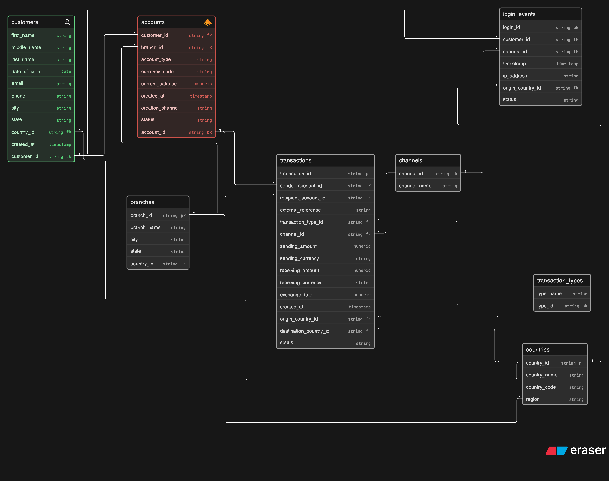

# RiskQL

SQL-driven banking risk analytics on a simplified global banking model in
PostgreSQL, with a Python notebook for EDA and charts.

This is a personal/learning project. It is **not** the internal system of
Bank of America or any other bank. All data is **synthetic** (see
`src/generate_data.py`) and does not represent real people or payments.
Anything the queries flag is an **indicator** that might be worth a closer
look, not proof of fraud, money laundering, or credit default.



## What this is trying to answer

A risk team sitting on customers, accounts, payments, channels, branches,
countries, and logins still has to turn that into something monitorable:

- Where do payment failures concentrate?
- Which channels and products fail more often?
- Are some corridors noisier than others?
- Do login failures or odd login geography sit near unusual payments?

Full write-up of the scenario: [`docs/business_scenario.md`](docs/business_scenario.md).

**In scope:** operational risk (failures, channel/process concentration,
authentication friction) plus supporting transaction, geo, and login
context.

**Out of scope:** credit risk, and anything that claims to "detect fraud"
without labels.

## Stack

PostgreSQL 16, SQL, Python, Pandas, SQLAlchemy, Matplotlib/Seaborn, Jupyter.

## Database

Eight tables. `transactions` is the one everything else hangs off.

- Customers can have several accounts and many login events.
- Origin and destination country are stored on the payment. Currency is
  **not** used as a stand-in for geography.
- External recipients: `recipient_account_id` is null and
  `external_reference` is filled in. No dummy "EXTERNAL" account.

Columns and constraints: [`docs/data_dictionary.md`](docs/data_dictionary.md).

## Data

I generated the book with `src/generate_data.py` (seed 42). There isn't a
clean public extract that has corridors, login origin vs KYC country,
channels, types, and account relationships all in one place, so I didn't
pretend a Kaggle file was the source.

Reference data (countries, types, channels, branches) is in `sql/seeds/`.
The bulk CSVs are git-ignored; rerun the generator to get them back.

| Table | Rows |
|---|---|
| countries | 15 |
| transaction_types | 6 |
| channels | 6 |
| branches | 12 |
| customers | 2,000 |
| accounts | 3,131 |
| login_events | 15,151 |
| transactions | 40,062 |

## Layout

```
RiskQL/
├── README.md
├── requirements.txt
├── .env.example
├── data/raw/              # reserved; this project is synthetic
├── data/processed/        # generated CSVs (git-ignored)
├── docs/                  # scenario, data dictionary, ERD
├── notebooks/risk_analysis.ipynb
├── reports/risk_analysis.md
├── reports/figures/
├── src/
│   ├── generate_data.py
│   ├── db.py
│   ├── analyze.py
│   └── validate_data.py
└── sql/
    ├── schema/
    ├── seeds/
    ├── run_schema.sql
    ├── load_data.sql
    ├── reset_public.sql
    ├── checks/
    └── analysis/
```

## Analysis

Queries live in `sql/analysis/`:

1. Transactions (volume, failures, value, monthly trend)
2. Customers
3. Accounts
4. Geography / corridors
5. Operational risk (channel, type, branch, time)
6. Logins
7. Combined login + payment indicators

Indicators are plain rules (failure vs book baseline, P99 value, login
failure rate, geo mismatch, failed login then a large payment within 24h),
then a count of how many fire. There is no opaque score.

## What I found

From the loaded book (see [`reports/risk_analysis.md`](reports/risk_analysis.md)
for the full write-up):

- **8.43%** of 40,062 payments failed. POS 13.1%, internet banking 10.1%,
  branch 3.4%.
- International remittances fail most by product (**13.3%** vs deposits
  **6.9%**).
- Amounts are skewed (median 493.68, mean 983.55, P99 7,569.41).
- **16.9%** of payments are cross-border. Five origin countries make up
  about 55% of volume.
- Login failure is **9.09%**. **8.77%** of logins come from a country
  other than the one on the customer record.
- **20** customers have clustered failed logins followed by a P99 payment
  within 24 hours.
- **72.5%** of customers trip 0 indicators; **1.0%** trip 3.

## How to run this

PostgreSQL 16+ and Python 3.10+. Homebrew `postgresql@16` is keg-only:

```bash
export PATH="/opt/homebrew/opt/postgresql@16/bin:$PATH"
```

```bash
pip install -r requirements.txt
cp .env.example .env
# set DATABASE_URL, e.g. postgresql://localhost:5432/riskql

createdb riskql   # skip if it already exists

# if the database already has tables, look first, then this wipes public
psql "$DATABASE_URL" -c "\dt"
psql "$DATABASE_URL" -v ON_ERROR_STOP=1 -f sql/reset_public.sql

psql "$DATABASE_URL" -v ON_ERROR_STOP=1 -f sql/run_schema.sql
python src/generate_data.py
psql "$DATABASE_URL" -v ON_ERROR_STOP=1 -f sql/load_data.sql

psql "$DATABASE_URL" -f sql/checks/data_quality.sql
python src/validate_data.py

psql "$DATABASE_URL" -f sql/analysis/01_transaction_analysis.sql
# same for 02 through 07

python src/analyze.py
jupyter nbconvert --to notebook --execute --inplace notebooks/risk_analysis.ipynb
```

Run the `psql` commands from the repo root so the relative paths work.

## Limitations

- Synthetic data with some patterns I put in on purpose.
- Mixing currencies in a sum is only indicative.
- Geo-IP is not a GPS coordinate.
- Thresholds are rules I chose, not a trained model.
- No fraud / AML / credit labels, so those risks are not estimated.
