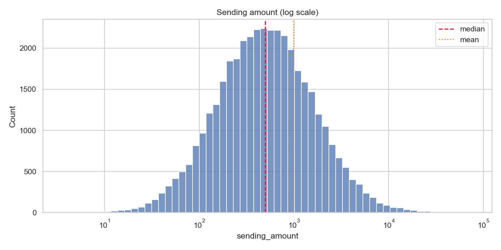
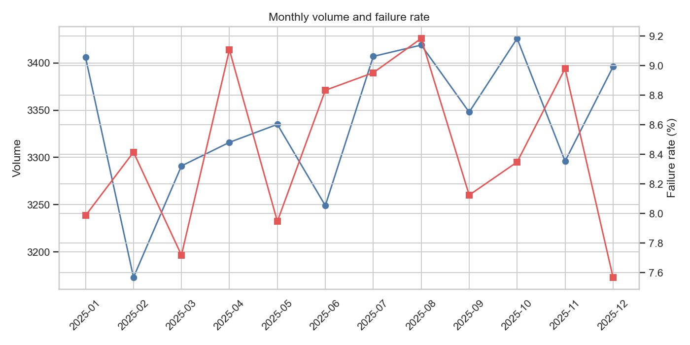
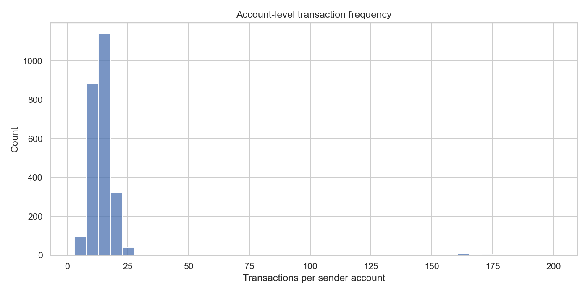
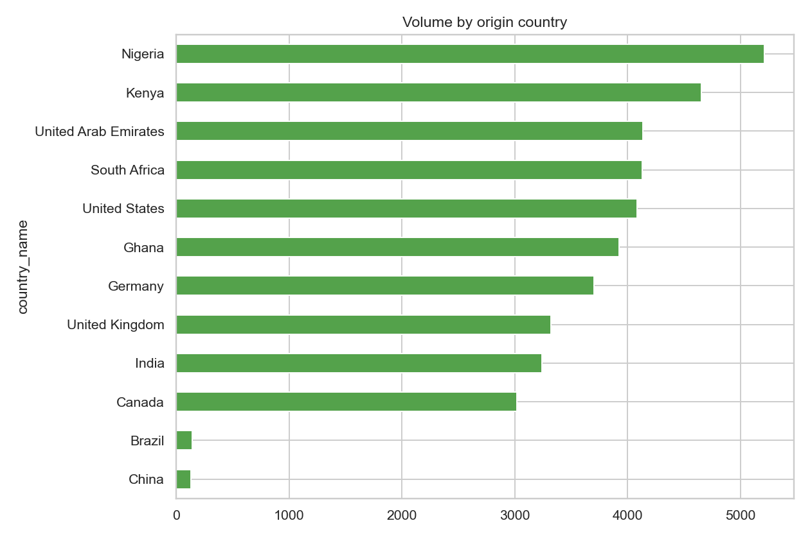
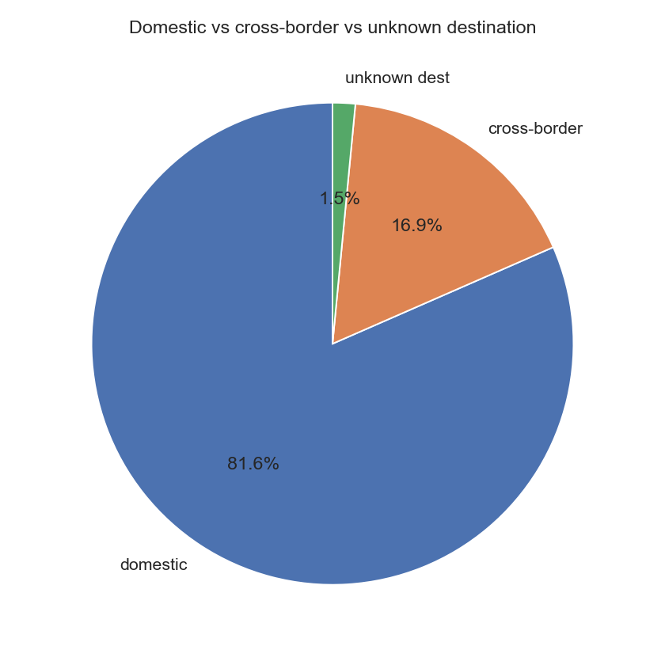
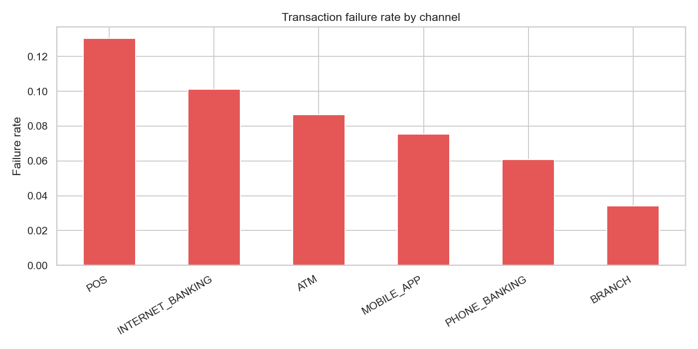
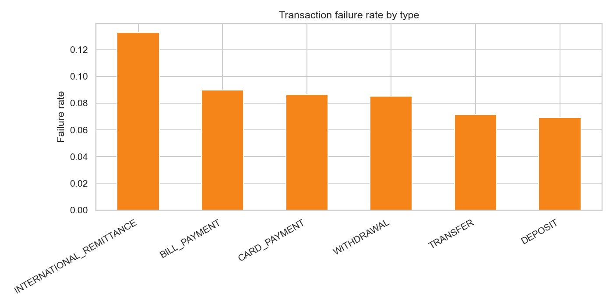
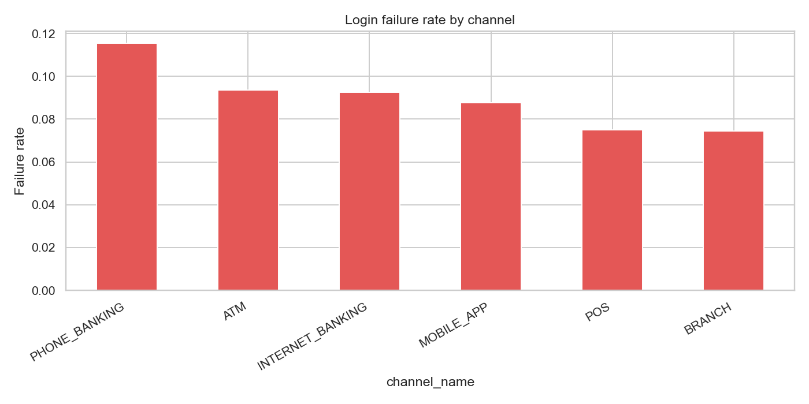

# RiskQL: Operational Risk Analysis Report

**Book window:** 1 January 2025 to 31 December 2025 (UTC)  
**Engine:** PostgreSQL 16 · **Data:** synthetic, seed 42  
**Audience:** Global Risk Management / operational-risk monitoring

All figures below were produced by running `sql/analysis/*.sql`,
`sql/checks/data_quality.sql`, and `src/analyze.py` against the loaded
database. They are not invented.

---

## 1. Executive summary

This book contains **40,062** payment attempts across **2,520** sending
accounts and **2,000** customers, plus **15,151** login attempts.

The headline operational rate is an **8.43%** payment failure rate and a
**9.09%** login failure rate. Failures are **not uniform**: POS payments
fail at 13.1% and international remittances at 13.3%, while branch payments
fail at 3.4%. That pattern is the primary monitoring set for operations.

**16.9%** of payments are cross-border. Origination is concentrated: the
top five origin countries account for about **55%** of volume, which
reflects where the model placed branches, not an emerging-risk event.

A transparent five-indicator count (failure, login failure, cross-border
share, P99 value, login-geo mismatch) puts **72.5%** of customers at zero
indicators and **1.0%** (20 customers) at three. **Twenty** customers also
show clustered failed logins followed by a P99-or-higher payment within 24
hours. Those lists are **investigation queues**, not determinations of
misconduct.

## 2. Business scenario

See [`docs/business_scenario.md`](../docs/business_scenario.md). In short: a
simplified global bank needs interpretable operational indicators from
payments, channels, geography, and digital authentication.

## 3. Risk-management context

| Risk type | Role in this project |
|---|---|
| Operational risk | Primary. Failure rates, channel/product concentration, time clustering, authentication failures. |
| Transaction / geographic context | Supporting. Cross-border share and corridor failure rates are exposure dimensions. |
| Credit risk | Out of scope. No facilities, arrears, or PD/LGD. |
| Financial crime | Out of scope as a *detection* problem. Unusual sequences are context for review, not SAR decisions. |

Basel-style operational risk includes process and system failures. Channel
and product failure rates map to that idea. They do **not** map to credit
loss or to a money-laundering typology.

## 4. Dataset and data sources

**Source:** synthetic generator `src/generate_data.py` (seed 42).  
**Not used:** Kaggle or any live bank extract. No public file supplied the
full conceptual model (internal vs external counterparties, explicit
corridors, login-origin vs KYC country, per-channel statuses) without
fabricating a provenance story.

| Table | Rows |
|---|---|
| countries | 15 |
| transaction_types | 6 |
| channels | 6 |
| branches | 12 |
| customers | 2,000 |
| accounts | 3,131 |
| login_events | 15,151 |
| transactions | 40,062 |

Injected (labelled) patterns: higher fail probability on POS / internet
banking / remittances; ~1.5% high-frequency sender accounts; ~8% geo-
mismatched logins; 20 watchlist customers with failed-login bursts then
large remittances.

## 5. Database architecture

Eight relations; `transactions` is the fact table. Keys, CHECKs (status
domains, positive amounts, ISO currency codes, recipient XOR external
reference, no self-transfer), and secondary indexes are defined in
`sql/schema/`. Geography is stored explicitly and is never inferred from
currency. External recipients are NULL account ids, not dummy accounts.

ERD: [`docs/erd/RiskQL_ERD.png`](../docs/erd/RiskQL_ERD.png).

## 6. Data quality and preparation

`sql/checks/data_quality.sql` (30 checks) and `src/validate_data.py` were
executed after load.

**Result: every ERROR and WARN check PASSED (issue_count = 0).** That
includes PK uniqueness, orphan FKs, non-positive amounts, negative
balances, invalid statuses, ISO currency format, self-transfers, recipient
XOR external reference, duplicate external references, and future dates of
birth.

Known structural limitations that checks cannot “fix”:

- Mixed-currency amounts are not converted to a single reporting currency.
- `current_balance` is a snapshot, not a reconstructed ledger.
- Casting `timestamptz` to `date` uses the session time zone (here
  `Africa/Lagos`, UTC+1). A few 31 Dec 2025 23:xx UTC payments display as
  1 Jan 2026 locally. Analyses that need a calendar day should convert
  `AT TIME ZONE 'UTC'` first.

## 7. Analytical methodology

SQL carries joins, grouping, windows, percentiles, and indicator logic.
Python (Pandas, Matplotlib, Seaborn) carries distribution plots and EDA.
Thresholds are **documented business rules**:

- High frequency: population mean + 3σ (descriptive outlier rule).
- High value: book P99 of `sending_amount` (7,569.41 in this book).
- Elevated customer failure: > 2× book failure rate, n ≥ 10.
- Elevated login failure: > 25%, n ≥ 5.
- Sequence window: 24 hours.

No hypothesis tests were run. Injected tails make classical “significance”
easy to misuse. Correlation is not treated as causation.

## 8. Transaction analysis

**Volume mix.** Transfers 29.7%; deposits / cards / withdrawals / bill
payments ~15% each; international remittances 9.9% (3,980).

**Outcomes.** Completed 88.67%; **failed 8.43%** (3,377); pending 1.94%;
reversed 0.97%. Pending and reversed are operational outcomes too; they
are not treated as success.

**Value.** Median 493.68 vs mean 983.55, so the distribution is right-skewed.
64.7% of payments sit in 100-1,000 (sending currency, indicative). P99 is
7,569.41; the largest
observation is 74,797.72. Mean > median is the reason a global cutoff
without a personal baseline is crude.

**FX shape.** 63.6% same-currency, 36.4% cross-currency. Cross-currency is
**not** the same as cross-border.

**Time.** Monthly failure rates stay in a band of about 7.6-9.2% through
2025. There is no operational incident spike in this book.

## 9. Customer and account analysis

**1,760** customers originate at least one payment (mean 22.8, median 17,
P99 173, max 317). **36** customers exceed mean + 3σ (threshold 96.3).
**2,520** sender accounts (mean 15.9, median 14); **37** exceed mean + 3σ
(threshold 72.3). Those tails match the generator’s high-frequency flag
and should be read as “busy accounts”, not as a fraud list.

Window-function outliers (amount > the *account’s own* mean + 3σ, n ≥ 10)
surface large payments that are unusual **for that account**. Several of
the largest sit on watchlist extra rows (`TX0000400xx`), which is the
injected remittance burst working as designed.

No customer with ≥ 15 payments routed ≥ 80% of volume through a single
channel. At a looser 60% / n ≥ 10 rule, 79 customers concentrate on one
channel, still a minority. Channel mix in this book is diversified.

Account type/status: origination is dominated by ACTIVE accounts, as
expected. Dormant or closed accounts originating material volume would be
an operational-control flag; the query in `03_account_analysis.sql` is the
monitor.

## 10. Geographic analysis

**Origination** is concentrated in branch countries: Nigeria 13.0%, Kenya
11.6%, UAE 10.3%, South Africa 10.3%, United States 10.2% (cumulative
**55.5%** after five countries). Countries without branches (France, China,
Egypt, Brazil, Australia) are each < 0.4%. That is book structure.

**Split:** domestic 81.56%; cross-border **16.92%**; unknown destination
1.52%.

Busiest corridors include Nigeria→South Africa, Kenya→Germany, and
Nigeria→UAE. **Elevated-failure corridors** (n ≥ 30 and above the 8.43%
book rate) include South Africa→Germany (17.5%) and several UAE-linked
pairs. Those are **processing** signals (timeouts, correspondent hours,
FX) until someone gathers context. They are not country-risk ratings.

## 11. Operational risk analysis

This is the primary lens.

**By channel** (failure rate): POS **13.06%**, internet banking **10.12%**,
ATM 8.65%, mobile 7.54%, phone 6.09%, **branch 3.41%**. Mobile still
contributes the most *failed counts* (1,208 of 3,377) because it is the
largest channel (16,022 payments).

**By product:** international remittance **13.29%**; bill 8.97%; card
8.64%; withdrawal 8.53%; transfer 7.15%; deposit 6.93%.

**By branch:** origination follows the branch footprint (Nairobi, Dubai,
Johannesburg, New York). Nigeria is split across three branches, so no
single Nigerian branch leads the volume table.

**Clock:** UTC hour-of-day failure stays roughly 7-10% with no operational
outage signature. Friday is slightly higher (9.26%) than Tuesday (8.02%).
Timestamps are UTC, so this is a book clock, not Lagos or New York local
time. The 7-day rolling failure rate in Q22 stays near the 8% band.

## 12. Digital activity analysis

Login outcomes: success 90.91%, **failed 9.09%** (1,377 of 15,151).

Phone banking logins fail most (11.5%); branch least (7.5%). Repeated
failures concentrate: customer CU000845 has 10 fails in 14 attempts
(71.4%). That is a service and security context (lockouts, credential
issues), not a payment-fraud label.

**Geography vs KYC country:** 88.33% match, **8.77%** differ, 2.90% unknown
origin. Geo-IP is approximate (VPN, corporate NAT, stale KYC country).

## 13. Combined risk indicators

**Sequence (Q27).** 20 customers have at least one failed login followed
within 24 hours by a payment at/above P99. This is exactly the watchlist
the generator injected, recovered by a generic rule. In production the
same pattern would open a **review**, because a mistyped password next to
a planned remittance looks identical.

**Login vs payment origin (Q28).** Among 4,757 payments that had a
successful login in the prior 7 days, **33.21%** had a payment origin
country different from that login origin. That rate is high enough that
it cannot be used as a blunt block rule; geo-IP plus travel plus 5% of
payments already originating away from the account’s branch country all
inflate it. Use it as context on an already-short list, not as a mass
alert.

**Indicator count (I1-I5):**

| Indicators tripped | Customers | Share |
|---|---|---|
| 3 | 20 | 1.00% |
| 2 | 57 | 2.85% |
| 1 | 473 | 23.65% |
| 0 | 1,450 | 72.50% |

Nobody in this book trips 4 or 5. A count of 3 is a short, explainable
queue. I4 (P99 payment) will fire for ~1% of payments by construction, so
it is common as a *single* indicator and should not be used alone.

## 14. Key findings

1. Operational failure is channel- and product-specific, not a flat 8%.
2. Value is skewed; personal baselines beat a single global cutoff.
3. Geography of origination follows the branch map; cross-border is a
   minority but material (16.9%).
4. Login failure and KYC/geo mismatch are useful **context** fields.
5. Combining authentication bursts with subsequent high-value payments
   produces a small, reviewable list.

## 15. Business implications

A GRM / operations partnership could:

- Monitor POS, internet banking, and remittance failure daily against the
  book baseline (currently 8.43%).
- Watch corridor-level failure for pairs that stay above baseline with
  adequate volume (n ≥ 30 rule used here).
- Keep a short combined-indicator queue (count ≥ 3, plus the 24-hour
  sequence) for **manual** context gathering.

None of those steps is an automated freeze, a SAR, or a credit action.

## 16. Recommendations

1. **Operations:** treat POS and remittance failure rates as first-line
   KRIs, with branch as a lower-bound comparison.
2. **Digital:** investigate customers with login failure > 25% on ≥ 5
   attempts (lockout/friction), separately from payment review.
3. **Investigations:** use I1-I5 counts and the 24-hour sequence as a
   **case-creation** input, not a risk score.
4. **Data:** add a reporting-currency rate table before anyone sums
   `sending_amount` across ISO codes for management reporting.

## 17. Limitations

- Synthetic data; injected patterns are recoverable by design.
- No FX-normalised totals.
- Geo-IP is not physical location.
- Mean + 3σ is sensitive to the injected high-frequency tail.
- 24-hour proximity is not causation.
- Session time zone vs UTC when casting timestamps to dates.
- No labels for fraud, AML, or credit default.

## 18. Future improvements

Reporting-currency conversion; a posting ledger for running balances;
local-time clocks per branch; a versioned raw extract in `data/raw/` if a
licensed public dataset is ever mapped in.
