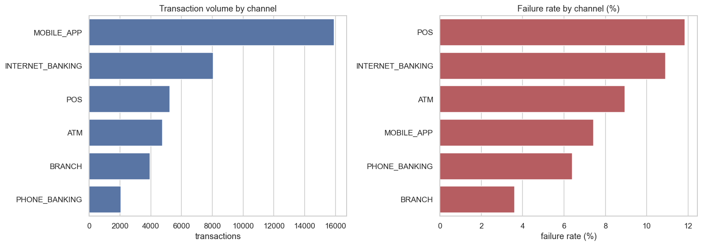
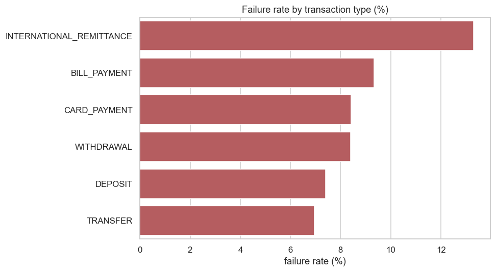
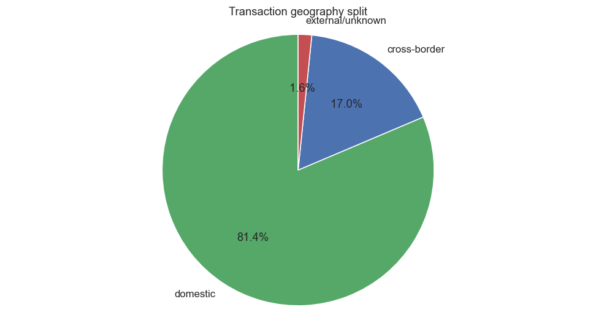
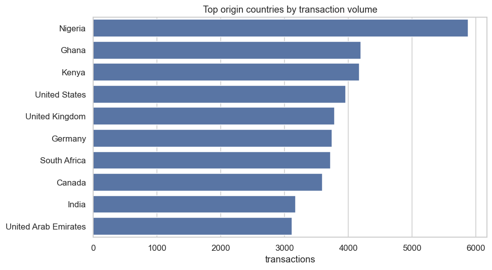
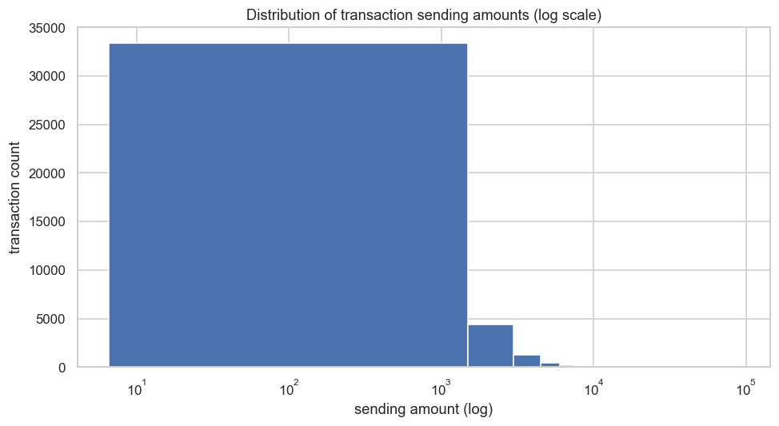
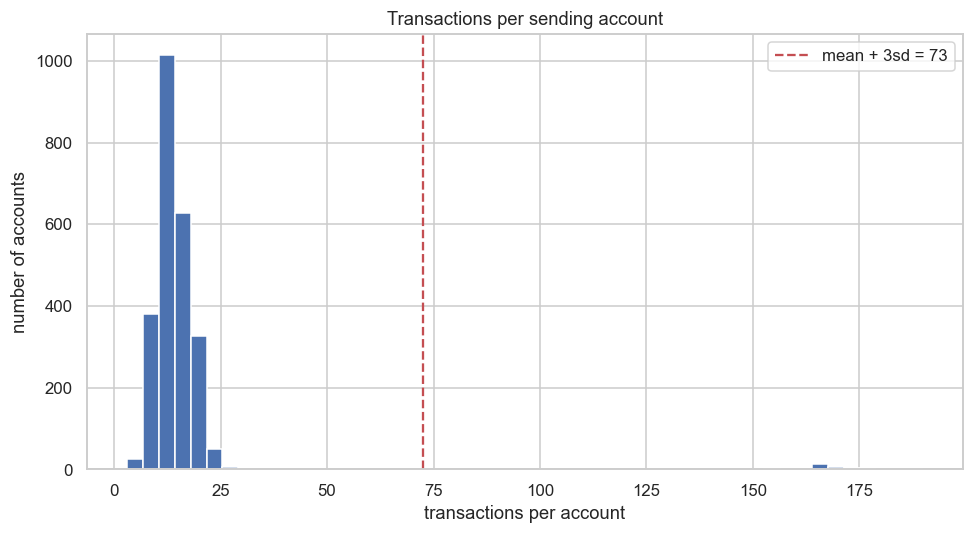
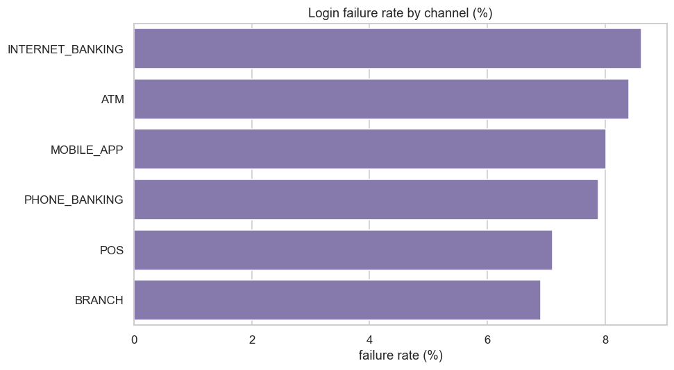
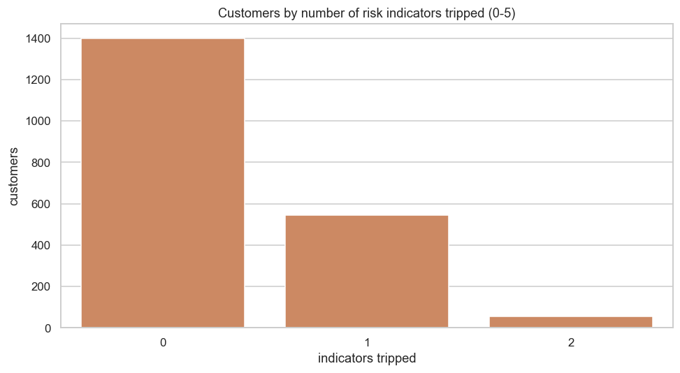

# RiskQL — Risk Analysis Report

> **Scope & disclaimer.** This report analyses **synthetic** data generated by
> `src/generate_data.py` for a conceptual global-bank model. It does not
> represent any real institution or person. Every result is a **risk
> indicator** — a pattern that *may warrant further investigation and requires
> additional context* — and never proof of fraud or financial crime. Monetary
> amounts mix currencies and are not FX-normalised, so value totals are
> indicative only. Figures below were produced from a single seeded run
> (`SEED = 42`); exact numbers reproduce on re-run.

---

## 1. Executive summary

RiskQL models a simplified global bank (customers, accounts, transactions,
logins, channels, branches, countries) and surfaces operational and supporting
risk indicators with SQL and Python.

On the current synthetic dataset (40,000 transactions, 15,000 logins, 2,000
customers):

- The **overall transaction failure rate is ≈ 8.5%**, and it is **not uniform**.
  It concentrates in remote / self-service channels (**POS ≈ 11.9%**, internet
  banking ≈ 10.9%) and in **international remittances (≈ 13.3%)**; the staffed
  **branch channel is lowest (≈ 3.6%)**.
- **≈ 17%** of transactions are **cross-border**; activity is geographically
  concentrated (top 5 origin countries ≈ 55% of volume).
- **Login failure ≈ 8.1%**; **≈ 7.6%** of logins originate from a country other
  than the customer's recorded country.
- A transparent five-indicator model flags very few customers: **≈ 70% trip zero
  indicators**, and only **≈ 2.8% trip two or more** — the intended behaviour of
  an interpretable indicator set.

These are the kinds of concentrations an operational-risk team would monitor and
investigate with additional context.

## 2. Business problem

A Global Risk Management function needs analytical indicators — not raw
operational logs — to answer: where are failures concentrated (by channel, type,
geography)? Which accounts or customers behave unusually? What share of activity
is cross-border? How often do logins fail, and from where? Can transaction and
digital activity be combined for better context? See
[`../docs/business_scenario.md`](../docs/business_scenario.md).

## 3. Data

Synthetic and clearly labelled (rationale in
[`../docs/development_notes.md`](../docs/development_notes.md)). Reference data is
hand-authored (`sql/seeds/`); bulk data is generated deterministically and loaded
via `COPY`.

| Table | Rows | Kind |
|---|---:|---|
| countries | 15 | reference |
| transaction_types | 6 | reference |
| channels | 6 | reference |
| branches | 12 | reference |
| customers | 2,000 | generated |
| accounts | ~3,100 | generated |
| login_events | 15,000 | generated |
| transactions | 40,000 | generated |

The generator intentionally injects interpretable patterns (channel/type failure
differences, high-frequency and high-value accounts, geo-mismatched logins) so
the analysis has genuine structure to detect.

## 4. Database architecture

Nine relations in third-normal-form-ish shape, with `transactions` as the central
fact-like table. Design highlights (full detail in
[`../docs/data_dictionary.md`](../docs/data_dictionary.md)):

- `NUMERIC` for all money; `TIMESTAMPTZ` for all event times; `TEXT` phones.
- Explicit origin/destination geography on transactions — **never inferred from
  currency**. `recipient_account_id` / `destination_country_id` are nullable to
  model **external/unknown** counterparties honestly.
- `CHECK` constraints enforce status/type domains and positive amounts;
  foreign keys enforce referential integrity; secondary indexes support the
  analytical queries.

## 5. Data quality

`sql/checks/data_quality.sql` implements 20+ explicit checks — primary-key
uniqueness, orphaned foreign keys, invalid amounts/balances/statuses/currencies,
impossible self-transfers, FX consistency, and duplicate business references —
and prints a PASS/FAIL line per check plus an overall summary.

On the loaded synthetic data **all critical checks PASS** (0 issues). The checks
are written to remain meaningful even if a constraint were relaxed or data came
from a less-trusted staging source.

## 6. Analytical methodology

Six SQL scripts progress from descriptive to analytical:

1. `01_transaction_analysis` — volumes, status/failure, value distribution.
2. `02_customer_risk` — frequency/value outliers using window functions and
   mean+3σ thresholds (population **and** per-account baselines).
3. `03_geographic_risk` — cross-border share, corridors, concentration.
4. `04_operational_risk` — channel/type/branch/time failure (primary focus).
5. `05_login_risk` — login failure and geography mismatch.
6. `06_combined_risk_indicators` — the five-indicator composite.

Failure rates use `count(*) FILTER (WHERE status='FAILED') / count(*)`. Small
samples are excluded with `HAVING`/minimum-count guards so a single event on a
tiny group doesn't masquerade as a trend. The Python notebook
(`notebooks/risk_analysis.ipynb`) re-runs representative queries and visualises
them.

## 7. Risk indicators

Five documented boolean indicators (thresholds in the SQL header):

| # | Indicator | Trips when |
|---|---|---|
| I1 | Elevated transaction failure | txn failure rate > 2× baseline, ≥ 10 txns |
| I2 | Elevated login failure | login failure rate > 25%, ≥ 5 logins |
| I3 | High cross-border share | > 50% of txns cross-border, ≥ 10 txns |
| I4 | High-value transaction present | ≥ 1 txn at/above the 99th percentile |
| I5 | Login geography mismatch | ≥ 3 logins from a non-recorded country |

**Composite = the count of indicators tripped (0–5).** There is deliberately
**no weighting and no opaque score**: with no labelled outcomes to learn from,
any weighting would be arbitrary. A transparent count is honest and explainable —
"this customer trips I2 and I5" can be handed to an analyst with the exact rule.

## 8. Findings

### 8.1 Operational failure is concentrated (primary focus)

Failures cluster in remote/self-service channels and in international
remittances; the staffed branch channel fails least.

Approximate failure rates: POS 11.9%, internet banking 10.9%, ATM 9.0%,
mobile app 7.4%, phone banking 6.4%, branch 3.6%. By type, international
remittance 13.3% down to transfer 7.0%. Overall ≈ 8.5%.

### 8.2 Geography: mostly domestic, concentrated origins

≈ 81% domestic, ≈ 17% cross-border, ≈ 1.6% external/unknown destination. Origin
volume is concentrated — the top five origin countries account for ≈ 55% of all
transactions.

### 8.3 Value and frequency are heavily skewed

A long right tail in both value and per-account frequency is exactly where the
high-value (I4) and high-frequency indicators originate. ~37 accounts sit beyond
mean + 3σ on transaction count.

### 8.4 Digital activity

Login failure ≈ 8.1% overall; ≈ 7.6% of logins come from a country other than the
customer's recorded country, with ≈ 2.9% of unknown origin.

### 8.5 Combined indicators

≈ 70% of customers trip zero indicators, ≈ 27% trip one, ≈ 2.8% trip two or more.
The set is intentionally conservative — it points to a small population that
*warrants context*, not a large list of "risky" customers.

## 9. Business interpretation

- The channel/type failure concentration is the clearest operational signal: it
  would justify investigating POS and internet-banking failure causes and the
  remittance process, since those drive a disproportionate share of failures.
- Cross-border and geo-mismatch rates are **context** signals. A high
  cross-border share or foreign login is normal for many customers (business
  accounts, travellers, expatriates) and only becomes interesting alongside
  other indicators — which is exactly what the composite count captures.
- The value/frequency tails identify a handful of accounts to *review*, not to
  action. "Unusually active" often means "legitimately busy".

## 10. Recommendations

1. Monitor channel- and type-level failure rates over time; alert on deviation
   from each channel's own baseline rather than a single global threshold.
2. Use the five-indicator count as a **triage** aid: prioritise customers tripping
   ≥ 2 indicators for context gathering, not enforcement.
3. Treat geo-mismatch and cross-border purely as context multipliers, never as
   standalone triggers.
4. Keep monetary analysis currency-aware; do not sum across currencies without
   FX normalisation.

## 11. Limitations

- **Synthetic data:** the patterns were designed in, so these findings validate
  the analytical pipeline, not real-world risk.
- **No FX normalisation:** cross-currency value totals are indicative only.
- **No ground truth:** there are no labelled outcomes, so indicators are not
  validated against real risk events and carry no probability of being "correct".
- **Indicators ≠ conclusions:** every output requires human context before any
  action.

## 12. Future work

- FX-normalise to a base currency for comparable value analysis.
- Add velocity/time-series indicators (change in an account's own rate over time).
- Materialise the heaviest aggregates as views for faster repeated analysis.
- Introduce a real public dataset for the dimensions it supports (hybrid), with
  synthetic fill-in kept clearly labelled.

---

*Generated for a learning portfolio. Reproduce all numbers with the steps in the
project README.*
